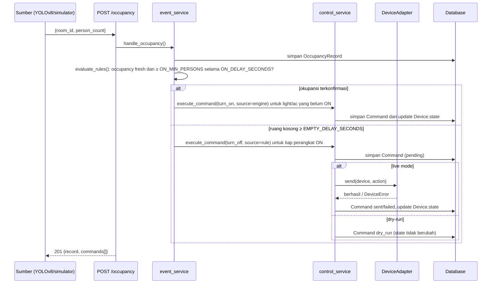
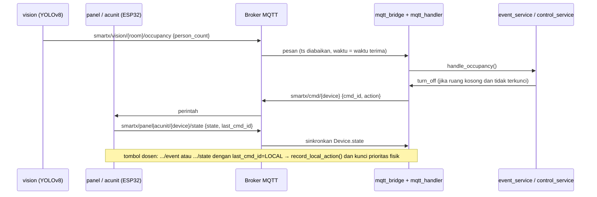
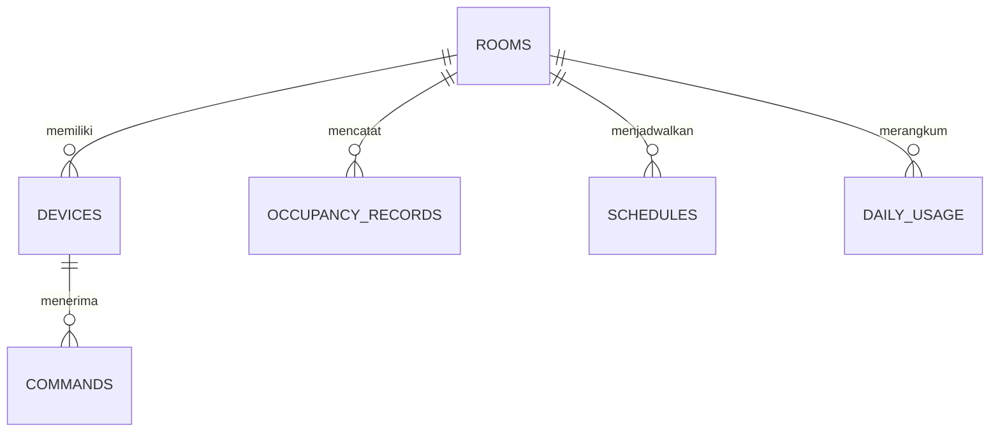

# Arsitektur HackX

Backend dashboard kontrol energi ruang kelas: menerima data okupansi, mengirim perintah ON setelah okupansi terkonfirmasi dan OFF setelah ruang kosong terkonfirmasi, serta mencatat setiap langkah supaya alurnya bisa dilacak.

Referensi: *An Intelligent System for Light and Air Conditioner Control Using YOLOv8* (JINITA 2024). Pembeda proyek ini: perhitungan emisi karbon dari hasil penghematan (`GET /dashboard/energy`, lihat [api-spec.md](api-spec.md)).

## Lapisan

```
 simulator / dashboard ── HTTP ──▶ app/api/*             ──┐
                                                           ├──▶ app/services/* ──▶ app/adapters/device_adapter.py ──▶ perangkat
 vision / panel / acunit ─ MQTT ─▶ adapters/mqtt_bridge  ──┘          │             (MqttDeviceAdapter atau simulasi)
        ▲                                    │                         │
        └──────── perintah ke smartx/cmd ────┘   app/models + app/db (SQLAlchemy)
```

| Lapisan | Folder | Tugas |
|---|---|---|
| API | `app/api/` | Terima request HTTP, validasi lewat `app/schemas/`, ubah error domain jadi kode HTTP |
| Layanan | `app/services/` | Logika bisnis: aturan kontrol, eksekusi perintah |
| Adapter | `app/adapters/` | Pemisah dari dunia luar: format data masuk, protokol perangkat, dan jembatan MQTT (`mqtt_bridge.py`) |
| Model/DB | `app/models/`, `app/db/` | Tabel dan koneksi. Layanan hanya memakai nama atribut Python, bukan nama kolom |

Aturan ketergantungan: API memanggil layanan, layanan memanggil adapter dan model. Tidak ada arah sebaliknya. Satu pengecualian disengaja: `mqtt_bridge` adalah pintu masuk (setara API) sehingga ia memanggil `services/mqtt_handler`, dan sekaligus menjadi adapter keluar (`MqttDeviceAdapter`). Rule engine sendiri tidak tahu MQTT; `mqtt_handler` tidak bergantung pada broker sehingga bisa dites tanpanya.

## Alur utama: data okupansi masuk



Perintah manual dari dashboard (`POST /commands`) memakai jalur yang sama mulai dari `execute_command`, dengan `source=manual`.

## Alur MQTT (perangkat nyata)

Dengan `MQTT_ENABLED=true`, `mqtt_bridge` tersambung ke broker Mosquitto (`deploy/mosquitto/`) sebagai akun `engine`. Kontrak topik dan payload ada di [mqtt-contract.md](mqtt-contract.md).



Hal penting pada jalur ini:
- **Waktu:** ESP32 tidak punya NTP, jadi `ts` dari payload diabaikan. Semua waktu (`detected_at`, `executed_at`, `last_changed_at`) adalah waktu terima di server, UTC.
- **Hasil pembacaan state:** laporan `.../state` menyinkronkan `Device.state`. Perangkat baru dikenal berstatus apa adanya di DB sampai ia melapor, sehingga perangkat sebaiknya mengirim `state` sekali saat tersambung.
- **Ack:** `services/ack_tracker.py` sudah ditulis tetapi belum dipasang ke bridge; sekarang perintah berstatus `sent` begitu dipublish ke broker (belum menunggu konfirmasi perangkat).
- **Ketahanan:** satu pesan rusak atau ID tidak dikenal hanya dicatat di log; loop MQTT tidak berhenti. Backend tetap naik walau broker belum siap (`connect_async`) dan menyambung ulang otomatis. Last Will `smartx/status/engine` menandai backend offline.

## Aturan kontrol (saat ini)

Aturan ON dan OFF berada di `app/services/event_service.py`:

> Auto ON: ketika `person_count >= ON_MIN_PERSONS` berkelanjutan selama `ON_DELAY_SECONDS`, engine menyalakan light/ac aktif yang belum `on` dengan source `engine`. Auto OFF: status `EMPTY` baru tercapai setelah `person_count=0` berkelanjutan selama `EMPTY_DELAY_SECONDS`.

- Default ON adalah 1 orang selama 2 detik; delay 0 berarti langsung pada pembacaan pertama. Pembacaan di bawah ambang, celah stale, atau status UNKNOWN mengulang timer ON.
- Waktu berasal dari saat pesan diterima server (UTC); timestamp payload vision tidak dipakai.
- Jika tidak ada pesan lebih lama dari `VISION_STALE_SECONDS` (default 6 detik), status menjadi `UNKNOWN`. `UNKNOWN` tidak pernah mengirim ON/OFF dari occupancy. Setelah data pulih, timer ON atau OFF dimulai dari pembacaan baru.
- Celah antar-pembacaan nol yang lebih panjang dari batas stale juga memutus kontinuitas, sehingga kamera berhenti tidak bisa dihitung sebagai ruang kosong.
- Auto ON hanya menyasar perangkat aktif berjenis `light` atau `ac` yang belum `on`; OFF hanya menyasar perangkat aktif yang sedang `on`. Perangkat yang sudah sesuai state tidak menerima perintah ulang.
- Perintah ON `engine` yang baru `sent` atau `dry_run` menahan duplikasi selama `VISION_STALE_SECONDS`; state yang sudah `on` tetap menjadi pengaman utama.
- Dalam dry-run, `state` perangkat tidak berubah. OFF dan ON yang sama tidak dibuat berulang.
- Perintah yang `failed` dapat dicoba lagi pada pembacaan berikutnya karena state perangkat belum berubah.

### Prioritas fisik (tombol dosen)

Saat tombol fisik ditekan, perangkat melapor dengan `last_cmd_id=LOCAL`. `record_local_action()` mencatat perintah `source=local` (tanpa mengirim apa pun, karena perangkat sudah berubah sendiri) dan menyinkronkan state.

- Untuk `LOCAL` + `turn_on`, dimulai **jendela kunci** selama `LOCAL_LOCK_SECONDS` (default 120 detik). Selama itu rule engine tidak mengirim OFF ke perangkat tersebut.
- Pengaman berlapis: `evaluate_rules` menyaring perangkat terkunci, dan `execute_command` menolak OFF bersumber `rule` dengan `PhysicalLockActive` (HTTP 409 lewat `POST /commands`).
- Setelah kunci habis, jeda kosong `EMPTY_DELAY_SECONDS` dimulai dari nol; hanya deret nol setelah waktu akhir kunci yang dihitung.
- Masa kunci **diturunkan dari riwayat tabel `commands`** (perintah `local` `turn_on` terakhir berstatus `sent`), bukan kolom baru, sehingga tetap utuh setelah server restart.
- Laporan `LOCAL` ganda dalam 2 detik (dari `event` dan `state`) dianggap satu penekanan. Pesan *retained* (replay saat perangkat atau backend menyambung ulang) tidak memulai kunci baru: pada topik `state` hanya menyinkronkan state, pada topik `event` diabaikan seluruhnya.
- Kunci hanya memblokir OFF dari **rule**. Perintah `manual` dari dashboard tidak ikut terkunci.

## Status perintah (`commands.status`)

| Status | Arti |
|---|---|
| `pending` | Baru dibuat, belum diproses (keadaan sesaat dalam satu transaksi) |
| `dry_run` | Hanya dicatat karena `CONTROL_LIVE_MODE=false`; perangkat tidak disentuh |
| `sent` | Terkirim ke adapter; `state` dan `last_changed_at` perangkat diperbarui |
| `failed` | Adapter melempar `DeviceError`; `state` tidak berubah, alasan dicatat di `reason` |

Setiap perintah tersimpan permanen di tabel `commands` dengan sumber (`manual`/`rule`/`engine`/`local`), alasan, dan waktu. Itulah jejak alur kontrol, dibaca lewat `GET /commands`.

## Model data



| Tabel | Kolom utama |
|---|---|
| `rooms` | `id`, `name` (unik), `building`, `capacity` |
| `devices` | `id`, `room_id`, `name`, `type` (`light`/`ac`), `state` (`on`/`off`/`unknown`), `power_watt`, `last_changed_at` |
| `occupancy_records` | `id`, `room_id`, `person_count`, `source`, `detected_at` |
| `commands` | `id`, `device_id`, `action` (`turn_on`/`turn_off`), `source` (`manual`/`rule`/`engine`/`local`), `status`, `reason`, `created_at`, `executed_at` |
| `schedules` | `id`, `room_id`, `day_of_week` (0=Senin..6=Minggu), `start_time`, `end_time`, `title`, `active` |
| `daily_usage` | `id`, `room_id`, `date`, `occupied_minutes`, `energy_kwh`, `idle_on_minutes`, `idle_energy_kwh`, `source` (`dummy`/`measured`); unik per ruang dan tanggal |
| `hourly_usage` | `id`, `room_id`, `date`, `hour` (0–23), `occupied_minutes`, `energy_kwh`; unik per ruang/tanggal/jam |

Timestamp operasional disimpan sebagai UTC tanpa zona (`utcnow()` di `app/db/session.py`). Jadwal memakai jam dinding setempat tanpa zona waktu. Agregasi tanggal kalender mengubah timestamp UTC ke zona lokal server, sehingga zona waktu server perlu mengikuti lokasi kampus.

### Jadwal kelas dan kalender penggunaan

`Schedule` adalah jadwal mingguan yang hanya dipakai untuk informasi dan rekomendasi UI. Endpoint jadwal serta kalender tidak dipanggil oleh `event_service`, `control_service`, atau jalur MQTT. Jadwal yang sedang berlangsung dapat ditampilkan sebagai konteks petugas, tetapi tidak menyalakan atau mematikan perangkat.

`DailyUsage` menyimpan agregat harian dan `HourlyUsage` menyimpan okupansi serta energi per jam. Saat aplikasi membuat tabel baru dengan `create_all`, kolom baru pada `daily_usage` lama ditambahkan lewat `python -m app.db.migrate`; migrasi mencadangkan SQLite sebelum mengubah skema. Seed 26 minggu deterministik mengisi tanggal yang belum ada dan melengkapi profil 24 jam untuk baris dummy lama. Seed membagi energi kosong 5–13% jika ada jejak OFF otomatis berstatus terkirim, atau 15–25% bila tidak ada, untuk memberi contoh tingkat pemborosan yang lebih tinggi ketika pemadaman otomatis belum efektif.

Cara menghitung riwayat terukur: sumber okupansi sintetis `simulator`, `dashboard`, `test`, dan `dummy` dikecualikan. Setiap pembacaan nyata berlaku sampai pembacaan berikutnya atau ambang basi `VISION_STALE_SECONDS`, mana yang lebih dulu; hanya interval dengan `person_count > 0` yang menambah waktu terisi, sedangkan `person_count = 0` membentuk interval kosong. Tanpa pembacaan baru, status dianggap tidak diketahui dan tidak dihitung sebagai kosong. Energi per jam memakai aturan integrasi yang sama dengan `energy_service.summarize()` pada `/dashboard/energy`: perintah `sent` membentuk transisi ON/OFF, sedangkan bila riwayat perintah tidak ada, status perangkat sekarang dipakai sebagai asumsi. Energi idle dijumlahkan dari daya semua perangkat yang ON selama interval ruang kosong. `idle_on_minutes` menghitung gabungan waktu ruang kosong saat sedikitnya satu perangkat ON, sehingga perangkat yang menyala bersamaan tidak menggandakan durasi. Data measured menimpa baris dummy per ruang/tanggal. Perhitungan ini hanya untuk tampilan dan tidak pernah menjadi input rule engine.

Utilisasi adalah `occupied_minutes / scheduled_minutes × 100` pada periode dan ruang yang sama; `null` bila tidak ada jadwal aktif. Nilai dapat melewati 100% bila okupansi nyata terjadi di luar jadwal. `idle_share_pct` adalah `idle_energy_kwh / energy_kwh × 100`, atau `null` jika energi nol. Perubahan periode membandingkan rentang berjalan dengan rentang sebelumnya yang sama panjang; pembagi nol menghasilkan `null`. Untuk `6m`, seri diringkas mingguan. Heatmap jam merata-ratakan menit terisi pada tiap pasangan hari/jam di seluruh ruang dan tanggal yang tersedia. Nilai sumber contoh ditandai agar UI dapat menampilkan catatan data dummy.

Heatmap kalender tetap menghitung `level` dari kuartil nilai nonnol; nol selalu level 0, dan bila semua nilai nol semua level 0. Jika agregat kalender mencampur data contoh dan terukur, sumber tanggal dikirim sebagai `mixed`.

## Konfigurasi

Dibaca dari `.env` (contoh di `.env.example`):

| Variabel | Default | Fungsi |
|---|---|---|
| `APP_ENV` | `dev` | Label lingkungan |
| `DATABASE_URL` | `sqlite:///./hackx.db` | Koneksi DB. Ganti untuk PostgreSQL/MySQL (aktifkan driver di `requirements.txt`) |
| `CONTROL_LIVE_MODE` | `false` | `false` = dry-run; `true` = perintah benar-benar dikirim lewat adapter |
| `MQTT_ENABLED` | `false` | `true` = jalankan `mqtt_bridge`; adapter perangkat menjadi `MqttDeviceAdapter` |
| `MQTT_HOST`, `MQTT_PORT` | `127.0.0.1`, `1883` | Alamat broker |
| `MQTT_USERNAME`, `MQTT_PASSWORD` | kosong | Akun `engine` (sandi di `deploy/mosquitto/credentials.txt`) |
| `MQTT_CLIENT_ID` | `engine` | Client id backend |
| `MQTT_TOPIC_PREFIX` | `smartx` | Prefix semua topik |
| `MQTT_ACK_TIMEOUT_SECONDS` | `0` | Batas tunggu ack perangkat; `0` = nonaktif (pelacak ack belum dipasang) |
| `LOCAL_LOCK_SECONDS` | `120` | Lama prioritas fisik setelah tombol dosen |
| `EMPTY_DELAY_SECONDS` | `20` | Lama okupansi nol beruntun sebelum rule mengirim OFF; demo 20 detik, produksi dapat memakai nilai lebih besar (mis. 300) |
| `VISION_STALE_SECONDS` | `6` | Tanpa pesan selama ambang ini, status menjadi UNKNOWN dan timer kosong/terisi direset; UNKNOWN tidak memicu ON/OFF |
| `ON_MIN_PERSONS` | `1` | Jumlah orang minimum untuk konfirmasi auto ON |
| `ON_DELAY_SECONDS` | `2` | Lama okupansi di atas ambang sebelum auto ON; `0` = langsung |
| `PREVIEW_URL` | kosong | URL HLS MediaMTX untuk `GET /preview` |
| `EMISSION_FACTOR_KG_PER_KWH` | `0.87` | Faktor emisi listrik (Jamali), perlu diverifikasi sebelum disitasi |

Perintah baru benar-benar sampai ke perangkat hanya jika `MQTT_ENABLED=true` **dan** `CONTROL_LIVE_MODE=true`.

## Titik penyambungan (tempat menyesuaikan nanti)

| Kebutuhan | Yang diubah | Yang tidak perlu disentuh |
|---|---|---|
| Protokol saklar lain (HTTP ke ESP32, Home Assistant) | Buat kelas baru dengan method `send()` di `device_adapter.py`, ganti `get_adapter()` (MQTT sudah ada: `MqttDeviceAdapter`) | `control_service`, `event_service`, API |
| Ubah topik atau payload MQTT | `services/mqtt_handler.py` (parsing) dan `adapters/mqtt_bridge.py` (subscribe/publish), lalu perbarui [mqtt-contract.md](mqtt-contract.md) | `event_service`, API |
| Format keluaran YOLOv8 | Lewat MQTT: `mqtt_handler.py` (`person_count`); lewat HTTP: `occupancy_adapter.to_occupancy()` | Layanan dan API |
| Tabel DB teman setim berbeda | `app/models/*` (pakai `mapped_column("nama_kolom_asli")` atau ganti `__tablename__`) | Layanan dan API |
| Aturan baru (nyalakan otomatis) | `evaluate_rules()` di `event_service.py` | Jadwal kelas adalah informasi UI dan tidak terhubung ke kontrol |

## Status dan hal yang belum diputuskan

Dibangun: model, skema, DB dummy + seed, lapisan kontrol, API, energi, simulator, frontend, jembatan MQTT, prioritas fisik, preview CCTV, Admin, jadwal kelas, dan kalender penggunaan.
Frontend: `frontend/index.html`, disajikan di `/ui/` dari origin yang sama dengan API. Dua layar dengan routing `#/` (ringkasan semua ruang) dan `#/ruang/{id}` (detail satu ruang); tanpa dependensi eksternal sehingga jalan tanpa internet.

Belum: uji dengan perangkat dan kamera asli serta pemasangan `AckTracker` ke bridge. Endpoint mutasi HTTP memakai `X-Admin-Token`; endpoint GET dashboard tetap terbuka dan MQTT belum memakai TLS. Jalankan uvicorn pada `127.0.0.1` jika dashboard hanya dibuka di laptop backend.

Keputusan terbuka:
1. Faktor emisi listrik yang dipakai dan sumber sitasinya.
2. Perlu tidaknya menyalakan perangkat otomatis saat ada orang masuk.
3. Skema DB teman setim (sekarang memakai DB dummy SQLite).

Riwayat perubahan dan alasan keputusan ada di [changelog.md](changelog.md).
